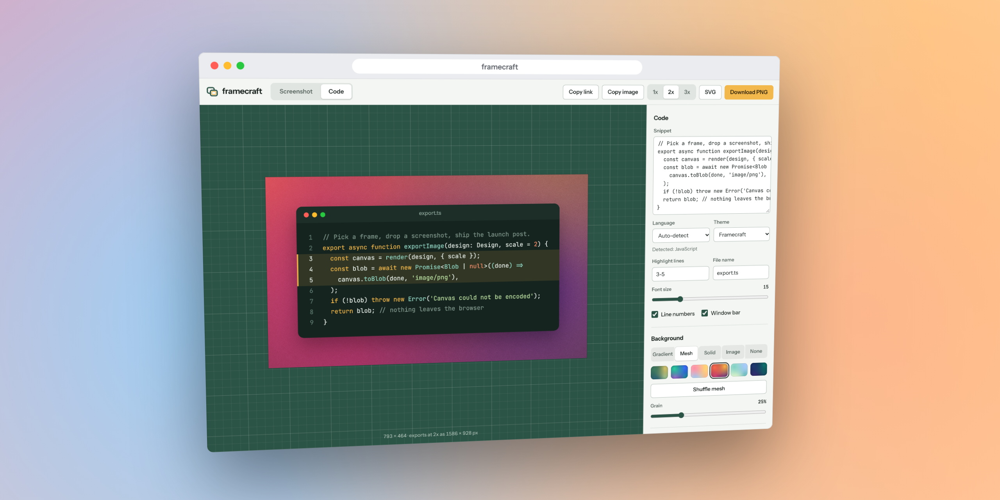
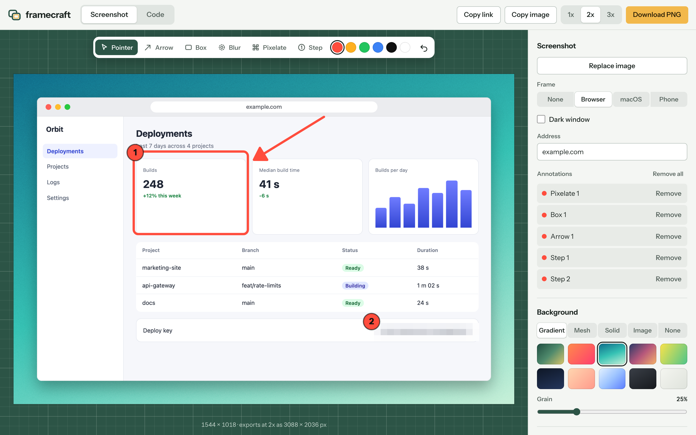
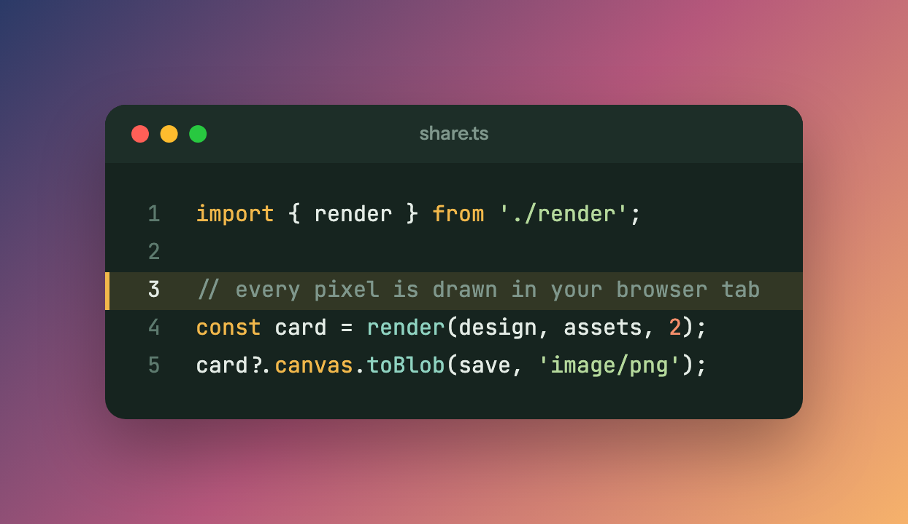
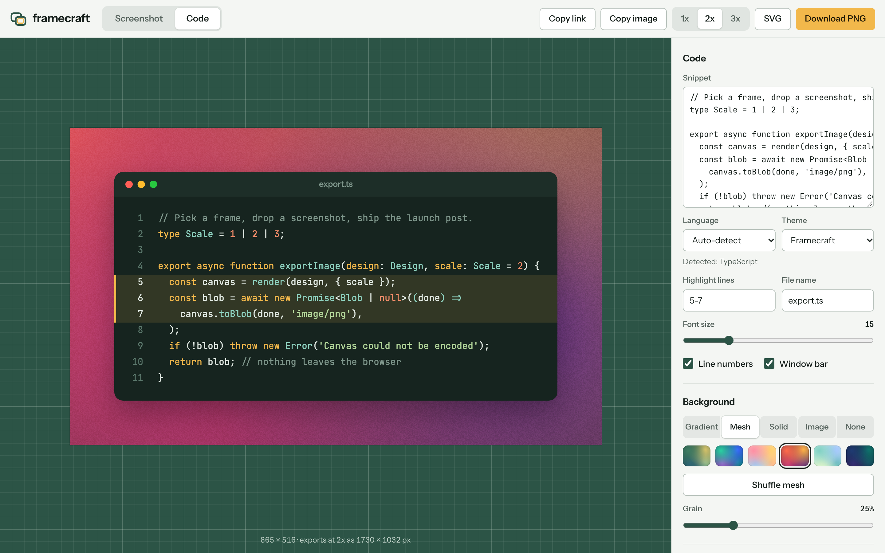

<p align="center"></p>

# framecraft

Turn a screenshot or a code snippet into a polished image for a README, a launch post or a social card.
Everything happens in your browser tab: images are never uploaded, and there is no server to send them to.

The image above was made with framecraft: it is framecraft's own screenshot, put in a browser frame,
tilted and exported at 2x by [`scripts/readme-images.mjs`](scripts/readme-images.mjs), which drives the real app.

## Quickstart

Needs Node.js 22 or newer.

```sh
git clone https://github.com/Habibeyilmazz/framecraft.git
cd framecraft
npm install
npm run dev        # opens on http://localhost:4210
```

`npm run build` writes a static site to `dist/` that you can host anywhere (it uses relative paths, so a sub-folder works).

## What it does

**Screenshot mode**



- Drop an image on the page, paste it with Ctrl+V / ⌘V, or pick a file (PNG, JPEG, WebP, GIF, AVIF).
- Frames: none, browser window (with an editable address), macOS window (with a title), phone. Light or dark windows.
- Annotations: arrows, boxes, numbered step badges, blur and pixelate. Blur and pixelate rebuild the region from a tiny
  downscaled copy (cells of at least 8 image pixels) and clear the original pixels first, so the exported file does not
  contain what you covered, and overlapping redactions never bring covered pixels back.
  Every annotation is listed in the sidebar with a Remove button; Ctrl+Z / ⌘Z undoes the last one.
- Keyboard: Tab to the preview, pick a tool, press Enter to add an annotation, arrow keys to move it (Shift for bigger
  steps), Alt+arrow keys to resize it or move an arrow's tip, Delete to remove it.

**Code mode**



- Syntax highlighting for 24 languages with [highlight.js](https://highlightjs.org/), including automatic language detection.
- Themes: Framecraft, One Dark, Dracula, Nord, GitHub Dark, GitHub Light, Solarized Light (palettes follow the published schemes they are named after).
- Line numbers, highlighted lines (`2, 4-6`), file name in the window bar, font size.

**Both modes**

- Backgrounds: 10 gradients, 6 mesh gradients (shuffle for a new arrangement), solid colour, your own image, or transparent; optional grain.
- Padding, corner radius, four shadow strengths, 3D tilt in two axes, and a caption above or below.
- Output sizes: fit to content, GitHub social preview (1280 × 640), README banner (1280 × 480), X post (1600 × 900),
  LinkedIn post (1200 × 627), Open Graph (1200 × 630), square (1080 × 1080).
- Export PNG at 1x, 2x or 3x, or copy the image straight to the clipboard. Exports over 16384 px on a side or
  120 megapixels are refused with a message instead of failing silently.
- Export SVG for code cards: the code stays real text with the fonts embedded, so it is sharp at any size
  ([example](docs/code-card.svg)). SVG is not offered for tilted cards, because SVG has no perspective transform.
- **Copy link** puts the whole design in the URL (compressed), so anyone who opens it gets the same look.
  Screenshots and background images are never put in the link.
- **Templates** save the look (not your image or code) in this browser's local storage.



## How it works

- One design object (`src/design.ts`) describes everything except images. It is validated whenever it comes from
  outside (a shared link or a saved template): unknown keys are dropped, numbers are clamped, strings are length-capped.
  The share link is that JSON, deflated with the browser's `CompressionStream` and base64url-encoded.
- `src/layout.ts` is pure geometry: content size, frame chrome, the output size and the scale that fits the card in it.
- `src/render.ts` draws with the Canvas 2D API: background, then the card (frame, image or code, annotations) on its
  own canvas at the final pixel size, then the card onto the background with a shadow. Tilt projects the card through
  a tiny WebGL quad so the texture is perspective-correct; a homography (`src/perspective.ts`) maps the mouse back
  onto the tilted card so annotations land where you click.
- `src/svg.ts` builds the SVG from the same layout numbers, so the PNG and SVG match.
- Fonts (Instrument Sans, JetBrains Mono) are bundled with the app, so it works offline and makes no third-party requests.

## Development

```sh
npm run typecheck  # TypeScript
npm test           # unit tests (Vitest)
npm run e2e        # end-to-end tests in Chromium (Playwright; builds and serves on port 4211)
```

The e2e tests use a made-up dashboard (`e2e/fixtures/fake-app.html`, screenshot regenerated by `e2e/make-fixture.mjs`).
To regenerate the README images, run `npm run dev` and then `node scripts/readme-images.mjs`.

A manual GitHub Pages workflow is included (`.github/workflows/pages.yml`). To use it, set Pages to "GitHub Actions"
in the repository settings, then run the workflow from the Actions tab.

## Roadmap

Not built yet:

- Selecting and editing any annotation after it is drawn (today the keyboard moves only the last one; otherwise remove and redraw).
- Text labels as an annotation.
- SVG export for screenshot mode.
- Custom output sizes and a custom gradient editor.
- More frames (iPad, Android, Windows window) and line wrapping for long code lines.
- Diff-style added/removed line markers in code mode.

## License

[MIT](LICENSE)
